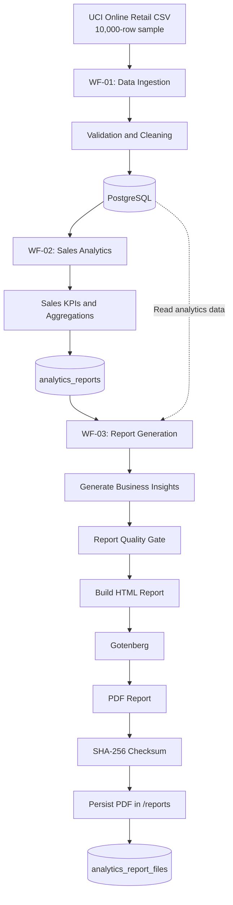
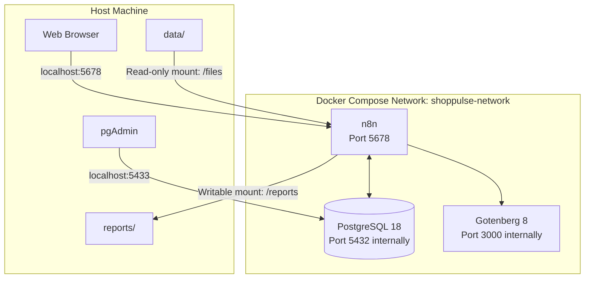
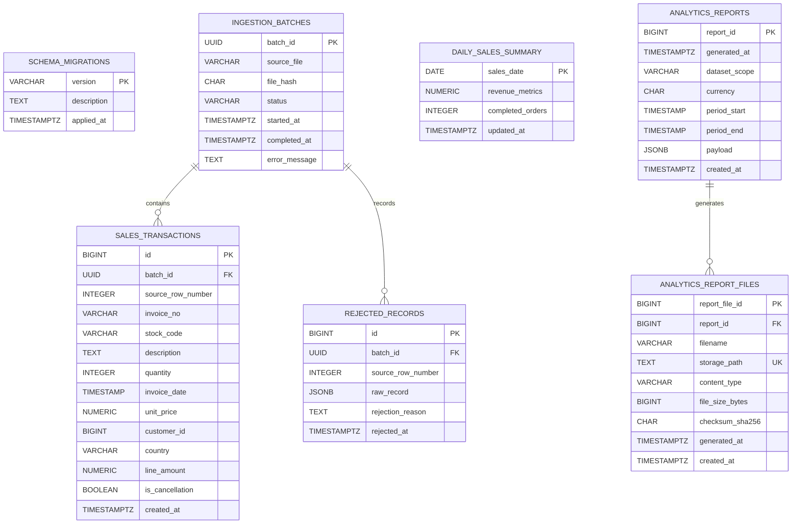

# ShopPulse — Automated Sales Analytics Pipeline

An end-to-end sales data engineering and analytics project built with **n8n, PostgreSQL, Docker, and Gotenberg**. ShopPulse automates CSV ingestion, data validation, sales analytics, business insight generation, and PDF report production.

The project demonstrates how to orchestrate a repeatable data pipeline with low-code workflow automation while keeping data storage, analytics, and reporting in a relational database.

---

## Table of Contents

- [Project Overview](#project-overview)
- [Key Features](#key-features)
- [Technology Stack](#technology-stack)
- [Architecture](#architecture)
- [Database Design](#database-design)
- [Workflow Details](#workflow-details)
- [Data Quality and Business Rules](#data-quality-and-business-rules)
- [Analytics Results](#analytics-results)
- [Prerequisites](#prerequisites)
- [Project Setup](#project-setup)
- [Running the Project](#running-the-project)
- [Running Migration Scripts](#running-migration-scripts)

---

## Project Overview

ShopPulse is an automated sales analytics pipeline built around the UCI Online Retail dataset.

The project uses a 10,000-row sample of retail transaction data. It processes the source CSV, records ingestion metadata, stores validated transactions in PostgreSQL, calculates sales KPIs, and generates a structured PDF analytics report.

Instead of manually executing scripts for each stage, n8n orchestrates the pipeline through three workflows:

| Workflow                  | Responsibility                                                                      |
| ------------------------- | ----------------------------------------------------------------------------------- |
| WF-01 — Data Ingestion    | Ingest, validate, clean, and persist sales data                                     |
| WF-02 — Sales Analytics   | Calculate sales KPIs and aggregate business metrics                                 |
| WF-03 — Report Generation | Generate insights, validate report sections, create a PDF, and persist its metadata |

### Project objectives

1. Build an automated and repeatable data ingestion pipeline.
2. Apply data quality and validation rules before persistence.
3. Store transactional and analytical data in PostgreSQL.
4. Automate sales KPI calculations and business reporting.
5. Generate PDF reports without manual intervention.
6. Implement SHA-256 checksums and idempotent metadata persistence.
7. Use Docker Compose to manage the application infrastructure.

---

## Key Features

### Automated data ingestion

- CSV-based ingestion using n8n.
- Ingestion batch tracking with unique batch identifiers.
- Duplicate transaction removal.
- Handling of cancellation transactions.
- Validation and rejection tracking.
- Persistence of validated records in PostgreSQL.

### Sales analytics

- Completed and cancelled order analysis.
- Gross, cancellation, and net revenue calculations.
- Average Order Value (AOV).
- Product performance analysis.
- Country-level sales analysis.
- Daily and monthly sales trends.

### Automated report generation

- Structured report sections for orders, revenue, products, geography, and time-series metrics.
- Deterministic, rule-based business insights.
- Report quality gate with 16 validation checks across four sections.
- HTML report generation.
- HTML-to-PDF conversion using Gotenberg.
- Persistent PDF storage.

### Data integrity and reliability

- SHA-256 checksum calculation for generated PDFs.
- File size and content-type validation.
- Idempotent PDF metadata insertion using a unique storage path.
- PostgreSQL constraints for metadata integrity.
- Foreign-key relationship between reports and their generated files.

### Containerized infrastructure

- Docker Compose-based deployment.
- Persistent PostgreSQL and n8n volumes.
- Separate application and database services.
- Gotenberg integrated over the internal Docker network.

---

## Technology Stack

| Technology        | Purpose                                                                                                  |
| ----------------- | -------------------------------------------------------------------------------------------------------- |
| n8n 2.45.7        | Workflow orchestration and automation                                                                    |
| PostgreSQL 18     | Transactional and analytical data storage                                                                |
| Docker            | Containerization                                                                                         |
| Docker Compose    | Multi-container application management                                                                   |
| Gotenberg 8       | HTML-to-PDF conversion                                                                                   |
| JavaScript        | Data transformation and business logic inside n8n Code nodes                                             |
| SQL               | Data persistence, aggregation, and analytics                                                             |
| UCI Online Retail | [UCI Machine Learning Repository — Online Retail](https://archive.ics.uci.edu/dataset/352/online+retail) |

---

## Project Structure

```text
ShopPulse/
├── data/
│   └── raw/
│        └── ...
│   └── samples/
│        └── ...
│
├── database/
│   └── init/
│       └── ...
│   └── migrations/
│       └── ...
│   └── queries/
│
├── workflows/
│   ├── WF-01-Data-Ingestion.json
│   ├── WF-02-Sales-Analytics.json
│   └── WF-03-Report-Generation.json
│
├── reports/
│   └── ...
│
├── scripts/
│   └── ...
│
├── backups/
│   └── ...
│
├── .env.example
├── .gitignore
├── docker-compose.yaml
└── README.md
```

---

## Architecture

### High-level architecture



### Docker infrastructure



### Service configuration

| Service    | Container name        | Access                           |
| ---------- | --------------------- | -------------------------------- |
| n8n        | `shoppulse-n8n`       | `http://localhost:5678`          |
| PostgreSQL | `shoppulse-postgres`  | `localhost:5433` from host       |
| Gotenberg  | `shoppulse-gotenberg` | `http://gotenberg:3000` from n8n |

**Important:** PostgreSQL listens on port `5432` inside Docker. The host port is mapped to `5433` because another PostgreSQL installation already uses port `5432` on the host.

Gotenberg is available to n8n through the internal Docker network and is not published as a host port.

---

## Database Design

ShopPulse uses PostgreSQL to persist ingestion information, transaction records, analytical results, and generated report metadata.

### Database name

`shoppulse_db`

### Tables

| Table                    | Responsibility                                            |
| ------------------------ | --------------------------------------------------------- |
| `schema_migrations`      | Tracks database schema migrations                         |
| `ingestion_batches`      | Stores ingestion batch information and processing results |
| `sales_transactions`     | Stores sales transaction records                          |
| `rejected_records`       | Stores records rejected during ingestion                  |
| `daily_sales_summary`    | Stores daily aggregated sales metrics                     |
| `analytics_reports`      | Stores generated analytics report payloads                |
| `analytics_report_files` | Stores metadata for generated PDF reports                 |

### Entity relationship diagram

The following diagram documents the confirmed report metadata schema and the verified foreign-key relationship. Other tables are included as entities, without assuming undocumented column definitions or foreign keys.



---

## Workflow Details

### WF-01 — Data Ingestion

**Objective:** Ingest and validate the source CSV before persisting transaction data.

Main processing stages:

1. Read the source CSV file.
2. Create and track an ingestion batch.
3. Parse and validate transaction records.
4. Remove duplicate records.
5. Handle cancellation transactions.
6. Separate valid and rejected records.
7. Persist transaction and batch information in PostgreSQL.
8. Record ingestion results.

Key ingestion results:

| Metric                 | Result |
| ---------------------- | -----: |
| Source rows            | 10,000 |
| Valid rows             | 10,000 |
| Rejected rows          |      0 |
| Duplicate rows removed |      2 |
| Cancellation records   |    188 |
| Missing CustomerID     |  2,516 |
| Missing Description    |     31 |

Missing `CustomerID` and `Description` values were accepted under the project's validation rules rather than automatically treating those records as invalid.

### WF-02 — Sales Analytics

**Objective:** Calculate business metrics from persisted transaction data.

Main analytical areas:

- Order completion and cancellation.
- Revenue and cancellation analysis.
- Average Order Value.
- Product-level performance.
- Country-level performance.
- Daily and monthly sales trends.

The workflow stores analytical results for downstream reporting.

### WF-03 — Automated Report Generation

**Objective:** Generate a validated PDF business report from the analytics snapshot.

Main processing stages:

1. Retrieve the latest analytics report.
2. Validate the report structure.
3. Prepare report data.
4. Generate order insights.
5. Generate revenue insights.
6. Generate product and geography insights.
7. Generate time-series insights.
8. Validate all insight sections.
9. Apply the report quality gate.
10. Assemble report sections.
11. Build the HTML report.
12. Convert HTML to PDF using Gotenberg.
13. Save the generated PDF under `/reports`.
14. Calculate its SHA-256 checksum.
15. Restore the original PDF binary alongside checksum metadata.
16. Prepare PDF metadata.
17. Persist metadata in PostgreSQL using an idempotent insert.

**Report quality gate:** Four report sections and 16 validation checks must pass before the report proceeds to final generation.

---

## Data Quality and Business Rules

The project applies explicit rules when processing the source dataset.

| Condition                                          | Project handling                           |
| -------------------------------------------------- | ------------------------------------------ |
| Duplicate transaction rows                         | Removed                                    |
| Cancellation invoice (`InvoiceNo` starts with `C`) | Identified and handled as a cancellation   |
| Missing CustomerID                                 | Accepted                                   |
| Missing Description                                | Accepted                                   |
| Invalid records                                    | Tracked through rejected-record handling   |
| Partial final month                                | Marked as partial in time-series reporting |

### Revenue definitions

The project distinguishes between gross, cancellation, and net revenue:

```text
Net Revenue = Gross Revenue - Cancellation Value
```

For this dataset:

```text
Gross Revenue       = £178,905.49
Cancellation Value  =   £6,385.09
Net Revenue         = £172,520.40
```

The cancellation rate is calculated using the project's invoice-level order counts:

```text
Cancellation Rate =
(Cancelled Orders / Total Invoices) × 100
```

Average Order Value:

```text
AOV = Net Revenue / Completed Orders
```

These definitions are important when interpreting the report: gross revenue, net revenue, invoice counts, and transaction-line counts are different measures.

---

## Analytics Results

The project processed a 10,000-row sample of the UCI Online Retail dataset.

### Overall sales performance

| Metric              |      Result |
| ------------------- | ----------: |
| Gross revenue       | £178,905.49 |
| Cancellation value  |   £6,385.09 |
| Net revenue         | £172,520.40 |
| Total invoices      |       6,091 |
| Completed orders    |       5,919 |
| Cancelled orders    |         172 |
| Cancellation rate   |       2.82% |
| Average Order Value |      £30.23 |
| Total items sold    |     102,864 |
| Distinct products   |       2,399 |
| Countries           |          34 |

### Additional findings

- Revenue retained after cancellations: **96.43%**.
- Revenue lost through cancellations: **3.57%**.
- The United Kingdom contributed approximately **84.03% of net revenue**.
- The highest gross-revenue day was **18 April 2011**, with £3,857.08.
- November 2011 was the highest-revenue complete month, with £23,765.41.
- December 2011 is treated as a partial month because the dataset ends on 9 December 2011.

All monetary values are in GBP.

---

## Prerequisites

Install the following before running the project:

- Docker Desktop with Docker Compose.
- Git.
- A modern web browser.
- pgAdmin (optional, for database inspection).

Verify Docker installation:

```bash
docker --version
docker compose version
git --version
```

---

## Project Setup

### 1. Clone the repository

```bash
git clone <YOUR_GITHUB_REPOSITORY_URL>
cd ShopPulse
```

Replace the repository URL with your actual GitHub repository URL.

### 2. Configure environment variables

Create a `.env` file in the project root:

```bash
touch .env
```

Add the following configuration:

```dotenv
POSTGRES_USER=shoppulse
POSTGRES_PASSWORD=change_this_to_a_secure_password
POSTGRES_DB=shoppulse_db

N8N_ENCRYPTION_KEY=replace_with_a_secure_random_key
N8N_PORT=5678
```

Generate a secure encryption key:

```bash
openssl rand -hex 32
```

Use the generated value for `N8N_ENCRYPTION_KEY`.

**Security:** Never commit `.env` or real credentials to Git. Keep `.env` in `.gitignore` and provide a sanitized `.env.example` for other users.

### 3. Prepare project directories

The Compose configuration expects these directories:

```bash
mkdir -p data reports database/init workflows
```

Place the source CSV in the `data/` directory.

The configured container mount makes the CSV available to n8n at:

```text
/files/samples/online_retail_sample.csv
```

The corresponding host path is:

```text
data/samples/online_retail_sample.csv
```

Ensure that the file is present at the expected path before executing WF-01.

### 4. Start the infrastructure

```bash
docker compose up -d
```

Verify running containers:

```bash
docker compose ps
```

Wait until PostgreSQL reports healthy before using the workflows.

### 5. Access the applications

| Application          | URL                     |
| -------------------- | ----------------------- |
| n8n                  | http://localhost:5678   |
| PostgreSQL from host | `127.0.0.1:5433`        |
| Gotenberg from n8n   | `http://gotenberg:3000` |

Complete the initial n8n setup and configure the PostgreSQL credentials in n8n.

For PostgreSQL, use:

```text
Host: postgres
Port: 5432
Database: shoppulse_db
User: shoppulse
Password: value from .env
```

Use the Docker service hostname `postgres` from inside n8n, not `localhost`.

### 6. Connect pgAdmin

Create a new PostgreSQL server connection in pgAdmin:

```text
Name: ShopPulse Docker PostgreSQL

Host: 127.0.0.1
Port: 5433
Maintenance database: shoppulse_db
Username: shoppulse
Password: value from .env
```

### 7. Import workflows

Import the exported WF-01, WF-02, and WF-03 workflow JSON files into n8n.

Before executing them:

- Configure the PostgreSQL credentials.
- Confirm the source CSV path.
- Confirm the required database schema and migrations are applied.
- Verify the Gotenberg URL is `http://gotenberg:3000`.
- Verify that `/reports` is writable by n8n.

Execute the workflows in order: WF-01, WF-02, then WF-03.

---

## Running the Project

### Start all services

```bash
docker compose up -d
```

### Check service status

```bash
docker compose ps
```

### View all service logs

```bash
docker compose logs -f
```

### View logs for an individual service

```bash
docker compose logs -f n8n
docker compose logs -f postgres
docker compose logs -f gotenberg
```

### Restart a service

```bash
docker compose restart n8n
docker compose restart postgres
docker compose restart gotenberg
```

### Stop all services

```bash
docker compose stop
```

### Stop and remove containers

```bash
docker compose down
```

This preserves named volumes and host-mounted project files.

**Warning:** The following command removes named volumes, including persistent PostgreSQL and n8n data:

```bash
docker compose down -v
```

Do not use it unless you intentionally want to delete that persistent data.

## Running Migration Scripts

```bash
docker compose exec -T postgres sh -c \
  'psql -v ON_ERROR_STOP=1 -U "$POSTGRES_USER" -d "$POSTGRES_DB"' \
  < database/migrations/001_initial_schema.sql
```

---
